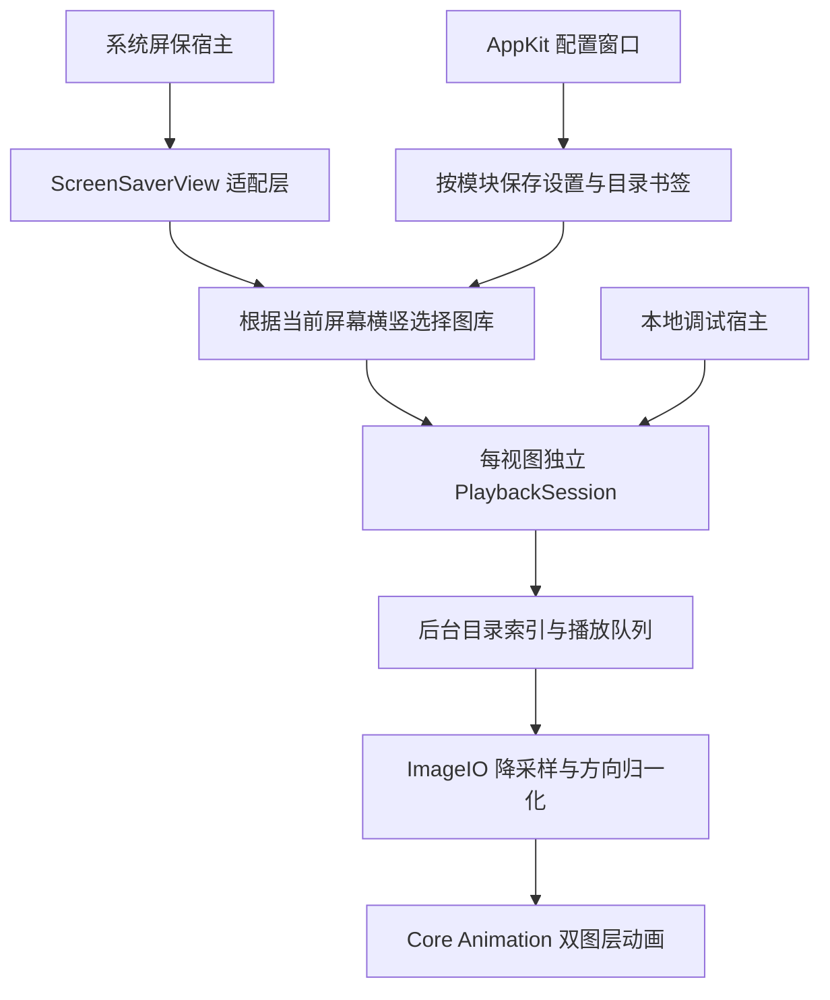

# 开发规划（已批准）

版本：0.2

日期：2026-10-18（Asia/Shanghai）

状态：**方案及 MIT 许可已批准；2026-10-18 开始执行 G1 最小原型与实机验证。G1 尚未全部通过，G2–G5 未启动。** 当前证据见 [G1 记录](validation/g1.md)。

## 已批准的决策

以下方案已经用户批准，执行入口为 [`goal_prompt.md`](../goal_prompt.md)：

1. **首选公开 API 的原生 `.saver`**，先做双屏、配置窗口和目录权限验证。通过后实现播放器；失败时提交具体证据，再决定是否接受私有 `.appex` 路线。
2. **按屏幕横竖方向选择两套图库**，不按“第一个/第二个屏幕”绑定。满足目前一横一竖的需求；同为横屏的两台显示器暂用同一个横屏图库。
3. **5 秒为相邻两张开始展示的间隔，1.5 秒为重叠过渡**；两者默认值按用户要求。重叠时两张照片都持续运动。
4. **默认填满并裁剪**，缩放上限默认 1.20；单张终点随机为 1.10–上限。首版上限可调范围为 1.10–1.20。透明照片先以同图模糊底图合成为不透明画面。
5. **首版仅本地文件夹、会话内一轮不重复**，随机为默认、递归为默认关闭。跨屏不保证全局去重，退出屏保后不保存播放历史。
6. **先交付可本机构建和验收的版本**，公开 GitHub 源码，采用 MIT 许可证；面向其他机器的签名、公证及二进制 Release 后置。

本次批准仅进入执行提示词交接，完整开发由用户在新会话启动。用户明确要求：先完成 G1 实机验证，通过后再开发完整功能；不允许带着 G1 待验证项提前进入 G2–G5。

## 1. 首版范围

### 必须完成

| 需求 | 具体约定 |
| --- | --- |
| 原生入口 | `MultiscreenSaver.saver` 出现在系统屏保选择界面；由系统启动/停止 |
| 两套图库 | 原生目录选择器指定横屏与竖屏目录；可选择相同目录 |
| 显示路由 | 视图挂接 window 后读取所在屏幕的完整 frame；宽 ≥ 高选横屏图库，宽 < 高选竖屏图库 |
| 动画 | 等比填充 + 缩放 + 平移；方向/终点随机；内容不拉伸，边缘不露底 |
| 过渡 | 交叉淡入淡出，不插入纯黑帧或降低合成不透明度 |
| 格式 | JPG/JPEG、PNG、HEIC、WebP，忽略扩展名大小写，验证实际解码 |
| 播放 | 随机/顺序切换；随机每轮无重复，换轮后重新洗牌；至少两张时避免上一轮末张紧接下一轮首张 |
| 子目录 | 全局“包含子文件夹”开关，默认关闭 |
| 设置 | 两个目录、每张时长、淡入淡出时长、缩放上限、随机/顺序、递归开关 |
| 异常 | 未配置、空目录、失效书签、移除磁盘、坏图、单图均有确定行为 |
| 生命周期 | 停止或移出窗口后取消工作、释放解码与访问；重复 start/stop 不创建多余定时器 |

### 暂不纳入

Apple Photos 相册/iCloud API、在线视频、动态壁纸、背景音频、人物识别/智能取景、图片编辑、任意数量显示器逐一指定图库、跨运行历史同步、HDR 原生输出、独立空闲检测器和 App Store 发布。

图库中的照片不必事先裁成 16:9 或 9:16。任意比例均能填充，但比例差异大时会有明显裁剪；首版不承诺主体始终完整。

## 2. 产品语义

### 参数及边界

| 设置 | 默认 | 建议允许范围/规则 |
| --- | --- | --- |
| 每张时长 `D` | 5 秒 | 2–120 秒；表示相邻两张入场起点间隔 |
| 淡入淡出 `F` | 1.5 秒 | 0–`min(5秒, D/2)`；0 表示直接切换，保证最多两张参与过渡 |
| 缩放上限 `Zmax` | 1.20 | 1.10–1.20；终点从 `[1.10, Zmax]` 随机选取 |
| 随机播放 | 开 | 关时按相对路径自然排序，完整相对路径用于稳定区分同名文件 |
| 包含子文件夹 | 关 | 两个图库共同使用该开关 |

UI 可将缩放上限显示为“最多放大 20%”。修改参数后必须验证有效范围；若新的 `D` 与旧 `F` 冲突，在保存前显示调整结果，不能悄悄保存非法值。配置采用带版本号的结构，损坏值恢复有效默认值。

### 时间轴

默认情况下：

| 时间 | 画面 |
| --- | --- |
| 0–5 秒 | A 持续缩放和平移；启动时首张准备好后直接显示 |
| 5–6.5 秒 | B 渐入覆盖 A；A、B 都继续运动 |
| 6.5–10 秒 | B 单独显示并持续运动 |
| 10–11.5 秒 | C 渐入覆盖 B；B、C 都继续运动 |

稳定播放时每张从入场到完全离场经历 `D+F=6.5秒`，每 5 秒启动一次切换；动画路径覆盖整个可见时段。按单调时钟计算进度，不按帧数累加，也不因系统时间调整产生跳跃。

首张只有退出过渡，没有从黑色淡入的强制过程。下一张未解码就绪时，保留当前完整画面，等待后再切换并重新建立时间基准；不会先移除旧图再加载新图。

### 图库与序列

- 每个播放实例持有独立的目录快照、随机数状态、序列与解码任务；两屏使用同一文件夹时仍各自播放，不保证跨屏不重复。
- 使用均匀洗牌的完整索引队列，逐一取出，不能每张独立抽签。跨轮首尾相同且可选图片 ≥2 时调整首张。
- 顺序模式按相对路径自然顺序循环。需要用测试固定数字文件名、大小写及同名不同子目录的排序语义。
- 跳过隐藏项、目录包、符号链接和 Finder alias，不跟随链接进入未授权位置或形成递归环。
- 初始扫描后台执行；本轮列表冻结，轮末后台重扫，下一轮纳入新增/移除文件。配置改变或重新激活也重扫；首版不引入持续文件系统监听。
- 单个坏图跳过并在当前会话隔离，避免无限重试；所有文件不可用时进入提示状态。整个目录失去访问则请求在设置中重新选择，不在锁屏播放期间弹授权框。
- 仅一张可用图时，继续同图的动画周期，并以同图交叉过渡平滑重置路径；该情况明确不适用“不同照片不重复”。
- 无可用图时显示低干扰中性背景和简短状态文字；不自动借用另一图库，避免隐藏路由或权限问题。“无黑边”验收指有图片正常播放的几何和过渡，不把空目录伪装成正常播放。

### 屏幕与预览

路由依据已挂接窗口的 `window.screen`，实际裁剪依据 view bounds；主屏编号变化不会交换图库。尚无 window/screen 或尺寸为零的实例暂不启动播放，不回退到 `NSScreen.main`。

显示器旋转、分辨率或 backing scale 改变后重新计算视口与图片预算，并在有效尺寸确认后应用；需要切换图库时取消旧实例任务，防止旧解码结果覆盖新状态。

系统缩略预览可能没有真实显示器语义，使用横屏图库作为明确默认，且不消费真正全屏实例的播放队列；调试宿主提供横屏/竖屏预览选择。不得只凭 `isPreview`、小窗口尺寸或是否锁屏中的单个信号决定真实实例归属；G1 记录系统实际行为后确定适配方式。

## 3. 工程架构

建议使用一个 Xcode 工程，包含 `.saver`、仅用于开发的预览 App 和核心逻辑测试 target。首版针对 macOS 27 / Apple Silicon 构建；不为了旧系统引入额外兼容层。若之后要求 Intel 或旧版 macOS，应另设支持矩阵。

| 模块 | 责任 |
| --- | --- |
| `ScreenSaverAdapter` | 公共屏保入口、生命周期、视口、配置窗口挂接 |
| `SettingsStore` / `FolderAccess` | 模块级设置、版本校验、只读书签、访问作用域 |
| `DisplayRouter` | 横/竖方向路由；不依赖屏幕枚举顺序 |
| `PhotoCatalog` | 可取消扫描、过滤、快照、轮末刷新 |
| `PlaybackSession` / `ShuffleBag` | 会话隔离、随机/顺序、预加载、坏图隔离、单调时间 |
| `ImageDecoder` | 后台 ImageIO、EXIF、sRGB 静态输出、透明图片背景、解码预算 |
| `KenBurnsGeometry` | 合法起终点、共享插值进度、覆盖不变量 |
| `PhotoRenderer` | Core Animation 图层、显式动画、不透明过渡、资源回收 |
| `ConfigurationController` | AppKit 设置窗口、目录验证、参数检查、保存/取消 |

核心逻辑不依赖系统屏保宿主；渲染实现以 Core Animation 为首选，无需一开始手写 Metal。几何方案见[调研报告](feasibility.md#4-ken-burns-与黑边约束)。避免用带隐式动画的逐帧属性更新，确保 `stopAnimation` 和移出 window 时显式停止所有动画、定时器、解码与目录访问。

## 4. 阶段与门槛

### G0：本轮调研与审阅

- 完成项目约定、公开 Git 仓库、可行性报告、现场核验和本规划。
- 已获用户批准并编写 `goal_prompt.md`、添加 MIT 许可证。交接会话不创建开发目标、不运行完整开发。

### G1：原生宿主可用性验证（优先阻断项）

做最小诊断 `.saver` 与配置窗口，使用两套自动生成且可区分的横/竖测试图片。在真实 macOS 27 宿主测试，不只跑预览 App。

验收内容：

1. 屏保能够出现在系统设置并加载；配置面板可选择和保存两个测试图库。
2. 主屏与副屏同时显示各自标记及至少一张对应测试图；使用 16:9 与 9:16 视口，不串图库；以简单色块平移和透明度变化确认 Core Animation 在真实宿主中能持续呈现。
3. 关闭设置、屏保停止后再启动，以及用户配合的系统重启后，目录授权仍可恢复。重启由用户在合适时机执行；未完成时该项为待验证，G1 不能通过。
4. 日志确认每个有效视图的屏幕归属、启动/停止/挂接行为；预览或零尺寸实例不消耗全屏队列。
5. 反复启停至少 10 次，没有增长的活动动画/解码任务，无需杀掉整个宿主来回收。

**通过门槛：** 上述全部必需项都有真实宿主证据且通过，写入 `docs/validation/g1.md` 后才进入 G2。任何失败、待验证或证据缺失均不满足门槛。若被系统 bug 或权限边界阻断，先完成最小复现和有限修复；仍不能通过时交付阻断报告，重新审议 `.appex` 或产品形态，不把 G1 标为完成。通过后自动继续已批准的 G2–G5，不重复征求开发许可。

安装本项目测试屏保、选择系统屏保、重启/锁屏等实机操作的范围及用户配合节点见 `goal_prompt.md`；交接时均未执行。任何测试均不更改用户锁屏密码策略。

### G2：配置、索引与序列

- 完成七项设置、配置版本校验、书签恢复及重新授权提示。
- 实现目录扫描、递归选项、随机轮播、顺序循环、坏图隔离和单图模式。
- 用确定种子检查序列性质；用合成目录覆盖 0、1、2、多图、重复文件名、中文名称及嵌套结构。

**通过门槛：** 配置重载一致；两套会话互不影响；一轮中有效路径无重复，所有候选均被处理；扫描/解码不会阻塞主线程。

### G3：Ken Burns 与连续过渡

- 完成 ImageIO 渲染输入、照片方向和色彩归一化、缩放平移与双图层过渡。
- 根据目标视口/缩放上限降采样，设置每张图与总在途解码内存上限；后台最多有限并发。
- 使用合成边缘标记图、纯色图和透明图进行自动覆盖检查及实际画面验收。

**通过门槛：** 宽高比和参数组合测试没有几何越界；过渡期间不露底、不暗闪、两张都持续移动；默认切换时序符合本文；坏图与加载延迟不会闪黑。

### G4：双屏集成与稳定性

- 在本机横竖双屏实测默认设置及边界参数、不同格式、长宽比、大图库。
- 连续运行至少 60 分钟，记录宿主/本项目的可区分资源指标及限制；完成 20 次启停、睡眠唤醒、旋转/拔插等可执行场景。
- 初步资源目标：两屏合计解码图片缓存不超过 512 MiB；预热后后半小时的内存不出现持续线性增长，回收后的比较点相对预热稳定值增长不超过 `max(50 MiB, 10%)`。GPU/宿主统计须单独记录，不能用缓存限额冒充总进程占用。
- 以不低于 30 fps 的可见动画流畅度为目标；记录帧间隔/长停顿及 CPU、GPU、内存观测值。框架计时回调或单元测试不能证明实际呈现帧率，必须结合渲染工具或画面检查。若当前宿主无法测量某项，标明未测。

**通过门槛：** 核心验收矩阵通过，性能目标有实测记录；任何未完成的人工场景保留“待验证”，不得以“构建成功”代替验收。

### G5：交付

- 交付可构建源码、`.saver` 构建方法、安装/配置/卸载说明、恢复原设置的方法和已知限制。
- 整理验收记录，说明系统 build、工具链、架构、样本来源、自动/人工覆盖范围。
- 根据批准后的授权提交和推送；不上传个人照片、书签、未脱敏路径或原始系统日志。
- 有有效 Developer ID 和后续发布授权时才完成签名、公证及二进制 Release；没有时如实交付本机构建版本，不关闭 Gatekeeper 或提供绕过系统保护作为默认安装路线。

## 5. 验收矩阵

| 编号 | 场景 | 合格标准 |
| --- | --- | --- |
| A01 | 横屏 H 图库 + 竖屏 V 图库 | 两屏始终各自取图，主屏身份变化不串库 |
| A02 | 16:9、9:16、1:1、超宽/超高照片交叉播放 | 所有运动及过渡帧满足覆盖约束，不拉伸 |
| A03 | 默认 5 秒 / 1.5 秒 | 按时间轴切换，过渡没有暗闪、停顿或突然复位 |
| A04 | 随机 N 张运行两轮 | 各轮无重复；N≥2 时轮间首尾不相同 |
| A05 | 顺序模式与递归开/关 | 顺序有确定规则；开关只影响扫描范围 |
| A06 | JPG/JPEG、PNG、HEIC、WebP | 真实宿主中都能播放；EXIF 各方向正确；静态首帧规则明确 |
| A07 | 透明 PNG/WebP | 不透明合成底图符合约定，无图层透明露底 |
| A08 | 0/1/2 张、坏图、文件被删、目录拒绝访问 | 不崩溃、不热循环；保留可用画面或显示状态 |
| A09 | 设置保存、取消、失效值、重新选择目录 | 保存持久；取消不生效；非法参数不可提交 |
| A10 | 预览与全屏并存、反复启停 | 队列不互相推进；停止后无活跃任务累积 |
| A11 | 旋转、拔插、唤醒、backing scale 变化 | 新视口和图库正确，旧解码不会回写新状态 |
| A12 | 60 分钟双屏与大图/大图库 | 资源受控，无持续内存增长和明显周期卡顿 |
| A13 | 从干净 checkout 构建 | 依照说明可重复构建；未承诺的签名条件明确 |

几何测试应覆盖固定边界案例与不少于 10,000 组确定种子的随机路径，每条在多个进度点检查覆盖；同时给出约束推导。画面检查使用图像覆盖/alpha 或边缘标记，不把照片本身的黑色像素误判成黑边。

## 6. 完成的定义与执行入口

目标模式的“完成”必须包括：可运行原生屏保、全部核心功能、相应自动测试、G1 实机证据、已执行的双屏稳定性验收及交付说明。只完成预览 App、只编译通过或用独立全屏程序替代，均不满足原目标。

`goal_prompt.md` 已明确批准范围、产品语义、G1 硬门槛、本机操作及用户配合节点、Git 推送范围与交付要求。缺少实机权限或用户配合时，只完成 G1 范围内可独立推进的工作，保留未验收状态；不得以提前开发完整功能代替实机验证。
